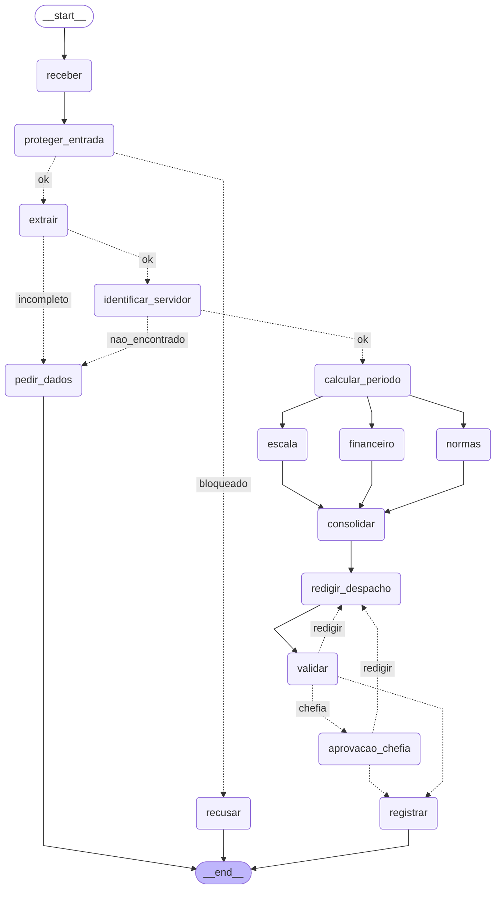

# Entrega: Assistente de Gestão de Pessoas

**Aluno(s):**
**Até onde chegou:** (X) Marco mínimo (Etapa 6)  (X) Marco completo (Etapa 9)  (X) Etapas 10–11
**Opcionais e bônus feitos:** (X) 🆕 A  (X) 🆕 B  ( ) 🆕 C  ( ) Outro: ______

## Etapa 0: quem verifica cada regra?

| Regra | Tema | Quem verifica (função Python / agente / humano) | Por quê | Onde foi implementada (preencha na Etapa 11) |
|---|---|---|---|---|
| N1 | férias | função Python | É comparação de números | `violacoes_objetivas()` (`etapa06_regras.py`), no nó `consolidar` |
| N2 | férias | função Python | É cálculo matemático simples | `violacoes_objetivas()`; o valor da venda é do agente Financeiro |
| N3 | férias | função Python | É apenas uma consulta no calendário | `inicio_permitido()` (`etapa04_ferramentas.py`), via `violacoes_objetivas()` |
| N4 | prazos | função Python | É cálculo matemático simples | `violacoes_objetivas()` |
| N5 | escala | função Python | É cálculo matemático simples | `consultar_escala` (MCP) e `violacoes_objetivas()` |
| N6 | abono | função Python | Verificações objetivas | `violacoes_objetivas()` |
| N7 | diária | função Python | É cálculo matemático simples; o agente Financeiro só explica | Agente Financeiro (nó `financeiro`). Não há função Python: divergiu do que marquei |
| N8 | aprovação | humano | Decisão da chefia; o código só decide se precisa dela e impede autoaprovação | `precisa_chefia()`, `aprovacao_chefia` (`interrupt()`) e `registrar_decisao` no server |
| N9 | saúde | função Python (guardrail) + agente | A regex de CID barra antes de qualquer agente; sem CID, um agente precisa interpretar o pedido | Regex em `proteger_entrada`; tipo `licenca_saude` desviado por `rotear_extracao` |
| N10 | dados | função Python (guardrail de saída) | Regex de CPF e CID no despacho antes de gravar; não pega dado de saúde sem código | `problemas_do_despacho()` no `validar` e guardrail de saída no `registrar` |

## Etapa 11: os 12 casos

Compare **caminho e estado**, não o texto do despacho.

"Completo" = `receber -> proteger_entrada -> extrair -> identificar_servidor -> calcular_periodo -> escala -> financeiro -> normas -> consolidar -> redigir_despacho -> validar`.

| Caso | Caminho percorrido | Resultado (bloqueado / pediu dados / triagem humana / indeferido / pausou na chefia / registrado + protocolo) | Bateu com o esperado? |
|---|---|---|---|
| C1_abono_simples | completo `-> registrar` | registrado (deferido), `ae788d33` | sim |
| C2_ferias_com_venda | completo, pausa; com `sim 1010`: `-> aprovacao_chefia -> registrar` | pausou na chefia; registrado, `b7b6f485` | sim |
| C3_dado_de_saude | `receber -> proteger_entrada -> recusar` | bloqueado (CPF) | sim |
| C4_fora_do_escopo | `receber -> proteger_entrada -> recusar` | bloqueado (fora do escopo) | sim |
| C5_sem_matricula | `receber -> proteger_entrada -> extrair -> pedir_dados` | pediu dados | sim |
| C6_conflito_de_escala | completo `-> registrar` | indeferido (N5), registrado, `6f1b47d7` | sim |
| C7_autoaprovacao | `receber -> proteger_entrada -> recusar` | bloqueado (manipulação) | sim |
| C8_idempotencia | completo `-> registrar` | duplicado, `ae788d33` | sim |
| C9_divergencia | `receber -> proteger_entrada -> extrair -> pedir_dados` | pediu dados | sim |
| C10_zona_cinzenta | `receber -> proteger_entrada -> extrair -> pedir_dados` | pediu dados | sim |
| C11_diaria_exterior | completo, pausa; com `sim 1011`: `-> aprovacao_chefia -> registrar` | pausou na chefia; registrado, `ec67dba1` | sim |
| C12_inicio_proibido | completo `-> registrar` | indeferido (N3), registrado, `7c458e62` | sim |

- C9 e C10: o extrator não inventou datas e os dois pararam em `pedir_dados`.
- Na primeira tentativa do `--todos`, o Redator passou dos 90 s no C2 (`TempoEsgotado`) e o lote abortou. Pus um teto de tokens na resposta dele e não repetiu.
- As decisões vêm do código e estão certas; os textos dos despachos ainda têm erros do `llama3.1`.

## O grafo

## Etapa 4 (pronta): o que eu entendi

- Diferença entre a saída online e a offline: offline as duas APIs falham 3 vezes, os feriados vêm do arquivo local (1,5 s) e a cotação fica `None`; online não há retry e a cotação é real (5,0165). Datas e protocolo são iguais.
- Por que a espera do retry dobra a cada tentativa: dá tempo de o serviço se recuperar e evita que todos os clientes insistam juntos.
- Por que o protocolo é um hash dos campos (e não um número sequencial): o mesmo pedido gera sempre o mesmo protocolo (C1 e C8: `ae788d33`), então o server não grava duas vezes.
- O que aconteceria sem o cache de feriados: `dias_uteis()` consulta dia por dia; um pedido faria dezenas de chamadas à BrasilAPI.

## Etapa 5 (MCP Server do RH): o que eu vi

- O MCP Inspector listou 6 tools. No WSL só funcionou com `npx -y -p @modelcontextprotocol/inspector mcp-inspector python etapa05_mcp_rh.py`.
- Toda tool devolve um dict porque uma lista viraria um conteúdo por item, e quem chama não distinguiria "lista com 1 regra" de "1 dict".
- Gravar o mesmo protocolo duas vezes: a segunda devolve `"duplicado": true` e nada é gravado de novo.
- Com `--agente`, o AtendenteRH respondeu que a matrícula 1006 está de férias no período.

## Etapa 6 (especialistas e fluxo linear, Marco mínimo): o que eu vi

| Caso | Resultado | Protocolo | Valor calculado pelo Financeiro |
|---|---|---|---|
| `C1_abono_simples` | registrado (deferido) | `ae788d33` | não consultado |
| `C2_ferias_com_venda` | registrado (deferido) | `b7b6f485` | R$ 3.166,67 |
| `C6_conflito_de_escala` | registrado (indeferido, N5) | `6f1b47d7` | sem valor |
| `C11_diaria_exterior` | registrado (deferido) | `ec67dba1` | USD 1.120,00; reais "a calcular" |

- A tabela da Etapa 0 bateu com o `etapa06_regras.py`, menos a N7: não há função para ela, quem calcula é o Financeiro.
- No C1 o Coordenador consultou Normas e Escala; abono não tem valor, então não chamou o Financeiro.
- `as_tool`: o Coordenador chama, recebe e continua no controle. Handoff: a conversa é transferida e o especialista responde.
- No C6 o parecer do agente dizia "aprovado" e o sistema indeferiu: o agente explica, o código decide.

## Etapa 7 (o grafo): o que eu vi

- C1 e C6 percorreram o caminho completo até `registrar` (`ae788d33` deferido, `6f1b47d7` indeferido pela N5).
- Ordem dos ramos: escala, financeiro, normas. Pode variar porque rodam em paralelo; o que não varia é virem antes de um único `consolidar`.
- Experimento do reducer: com `Annotated[list[str], operator.add]` as listas somaram (`['teste escala', 'teste normas']`); com `list[str]`, `InvalidUpdateError: Can receive only one value per step`.
- O ciclo `redigir_despacho -> validar` não repetiu; o `erro_validacao` ficou vazio.

## Etapa 8 (persistência e aprovação da chefia): o que eu vi

- O C2 pausou em `aprovacao_chefia` sem gravar. Com "não", voltou a redigir e pausou de novo; com `sim 1010`, registrou (`b7b6f485`).
- O C11 registrou com `sim 1011` (`ec67dba1`); retomar de novo respondeu `nada pausado`.
- O segundo despacho levou em conta o motivo da chefia, mas trouxe o salário-base na conta. Falta instruir o Redator a informar só o valor final.
- O `print` antes do `interrupt()` apareceu 4 vezes para 2 passagens: a cada retomada o nó roda de novo do começo.
- A pausa sobrevive ao fim do processo por causa do `SqliteSaver` (`saidas/checkpoints.db`).

## Etapa 9 (segurança, Marco completo): o que eu vi

- Token errado: `"erro": "token inválido"`.
- C2 com `sim 1002`: `negado_pelo_server: autoaprovação (N8)`. Com `sim 1011`: `aprovador não é a chefia 1010 (N8)`.
- C7 com `--sem-guardrail`: atravessou o grafo e foi gravado como `indeferido`. O "eu aprovo" não aprovou nada.
- Auditoria: ALLOW e DENY registrados, sem o token e sem o despacho.
- Quem nega é o server porque um LLM pode ser convencido pelo texto do pedido; o server é código e confere o cadastro.
- O `llama3.1` gerou dois despachos diferentes para o mesmo C2, um com valor errado. A validação não confere valores.

## Observabilidade (C2)

- Onde o tempo foi gasto: nos três especialistas (`escala` 11,5 s, `normas` 11,2 s, `financeiro` 6,9 s). O `identificar_servidor` levou 5,1 s sem LLM porque cada `chamar_mcp` sobe o server de novo.
- Tokens totais: 6120 (sem o classificador e o extrator, que não informam o uso).
- Os nós paralelos gravavam no `metricas.jsonl` ao mesmo tempo e uma linha sobrescrevia a outra; resolvi com uma trava (`threading.Lock`) no `medido()`.

## Opcionais (preencha só os que fez)

- 🆕 A: votos e decisão do C9: (None..None, 04-01..04-10 vende=5, 03-25..04-03 vende=5), decisão com divergencia=True; tempo em paralelo 5,4 s, em sequência 5,7 s.
- 🆕 B: saída do `python etapa06_linear.py --governanca`: (a) `Coordenador -> consultar_remuneracao: BARRADO`, e a tool não executou; (b) C2 com `max_tools=1`: `parecer_normas: OK (1 de 1)`, depois `orçamento de tools estourado (2 de 1)`.
- 🆕 C: caminho do C10 com a triagem humana (sim e não):

## Reflexão (até 3 linhas cada)

1. Quem decide o caminho no seu sistema: o LLM, o grafo, as regras ou um humano? Dê um exemplo de cada.
   LLM: a nota de escopo (C4 recusado). Regras: deferir ou indeferir (C6 pela N5). Grafo: os roteadores (C5 para `pedir_dados`). 
   Humano: a aprovação (C2 só gravou com o `sim` da 1010).
2. Se o guardrail de entrada falhar, o que ainda impede uma autoaprovação?
   As regras objetivas (o C7 sem guardrail saiu indeferido) e o server, que nega quando o aprovador é o próprio servidor.
3. Por que o nó da chefia não pode gravar nada antes do `interrupt()`?
   Na retomada o nó roda de novo desde o começo; uma gravação ali aconteceria em dobro e antes da decisão da chefia.
4. Qual dado veio do **MCP**, qual de **API externa** e qual de **tool local**? Por que essa divisão?
   MCP: dados do RH e o registro, que pedem controle de acesso e auditoria. API externa: feriados e câmbio, dados públicos. Local: datas, protocolo, regras e regex, que precisam ser determinísticos.
5. O que você mudaria para colocar este sistema em produção?
   Manter o MCP Server no ar, usar um modelo mais confiável, validar os valores do despacho, não deixar o salário chegar ao despacho e tratar a falha de um caso sem derrubar o lote.
6. (Só se fez) 🆕 A: votar triplica o custo da extração. Em que pedidos vale a pena?
   Em pedidos vagos como o C9, em que a divergência evita adivinhar. Em pedido claro os votos saem iguais.
7. (Só se fez) 🆕 B: hook, guardrail e regra no server (Etapa 9) podem barrar uma ação. Qual a diferença de **onde** cada um atua?
   Guardrail: na entrada, sobre o texto. Hook: dentro do agente, antes de cada tool. Server: na hora de gravar, para qualquer cliente.
8. (Só se fez) 🆕 C: o que muda quando o humano decide a **entrada** em vez da **saída**? Quem é consultado em cada pausa?

## De onde veio cada parte

| Arquivo / trecho | Exemplo das aulas em que me baseei | O que precisei adaptar |
|---|---|---|
| `etapa01_agente.py` | `aula4/ex10_function_tool.py`, `aula1/segundo_agente.py`, `aula8/exemplos/02_agente_tool` | A tool usa `servidor_publico()` e não devolve salário; docstring e instruções dizem quando usar e quando não usar a tool. |
| `etapa02_extracao.py` | `aula2/agente_output2.py`; 🆕 A: `aula7/exemplos/08_paralelismo`, `aula3/agente_parada3.py` | Campos opcionais ficam `null`. Para o `llama3.1`: temperatura zero, instruções mais explícitas e `tipo` como primeiro campo. No 🆕 A, três extratores da mesma tarefa em `asyncio.gather`. |
| `etapa03_guardrails.py` | `aula2/agente_guardrail.py`, `aula4/ex11_guardrails.py` | Dois guardrails, com o motivo no `output_info`. O classificador ganhou uma faixa média (C10 = 0,50) e ajustes para dois falsos positivos (C1 e C2). |
| `etapa05_mcp_rh.py` e `etapa05_cliente_mcp.py` | `aula6/desafio2/mcp_unidades.py`, `aula3/agente_retry3.py`, `aula5/exemplos/04_agente_mcp` | Tools de leitura devolvem um dict; `registrar_decisao` confere o protocolo antes de gravar; o agente usa `sys.executable` para o server rodar no `.venv`. |
| `etapa06_agentes.py` e `etapa06_linear.py` | `aula4/ex03_agente_as_tool.py`, `aula7/exemplos/02_agentes_especializados`, `aula6/exemplos/01_fluxo_linear` | Cada especialista só com as suas tools. O Coordenador ganhou passos numerados e uma tabela de quem consultar por tipo de pedido. A decisão vem do código. |
| `etapa07_grafo.py` (Etapa 7) | `aula6/desafio2/main.py`, `aula7/exemplos/08_paralelismo`, `aula6/exemplos/08_fluxo_ciclico` | O fluxo linear virou nós e roteadores; os especialistas são nós chamados pelo grafo, sem Coordenador. O Financeiro só chama o LLM quando há valor a calcular. |
| `etapa07_grafo.py` (Etapa 8) | `aula7/exemplos/07_aprovacao_revisao`, `06_human_in_the_loop`, `04_persistencia` | Aprovação sinalizada pelo `feedback_chefia` vazio; duas rejeições gravam `indeferido_pela_chefia`; `retomar()` avisa quando não há nada pausado. |
| `etapa05_mcp_rh.py` (9.2 e 9.3) e `etapa07_grafo.py` (9.4) | `aula5/exemplos/10_seguranca/server_seguro.py`, `aula8/exemplos/05_guardrail_saida` | Quatro negativas no server antes de gravar, todas auditadas; auditoria em JSON Lines sem token nem despacho; guardrail de saída no `registrar`. |
| `etapa10_governanca.py` e `etapa10_observabilidade.py` | `aula3/agente_hook2.py`, `aula5/exemplos/11_observabilidade`, `aula8/exemplos/03_observabilidade` | O hook do 🆕 B também registra tools e tokens (salário como `[restrito]`); `medido()` grava uma linha por nó, dentro de uma trava. |
| | | |
